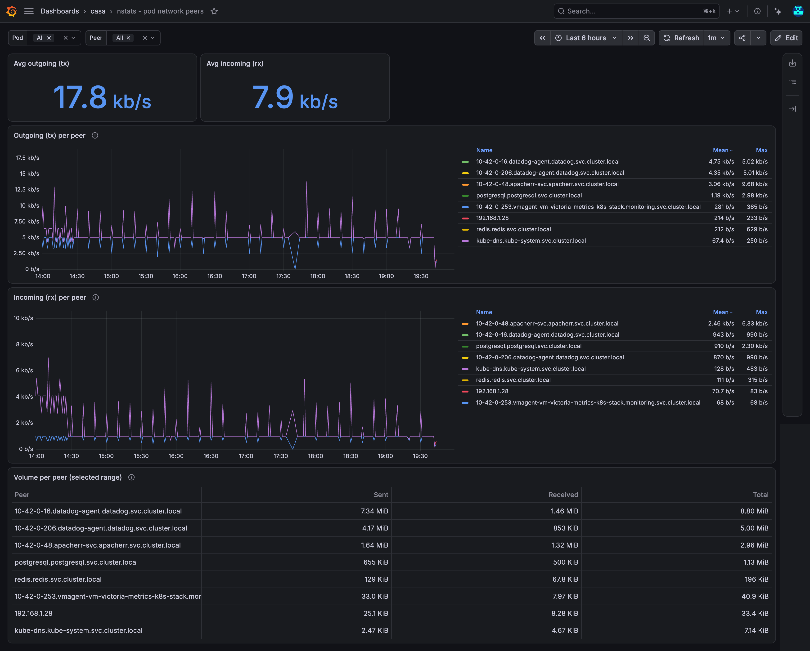

### Table of Contents

  * Introduction
  * The Problem
  * What nstats Does
  * How It Works
  * Names, Not Numbers
  * What You Get in Grafana
  * Footprint and Security
  * What It Taught Me
  * Conclusion
  * Reflections


Here we are, with another weird sidecar container.

## Introduction

Every Kubernetes dashboard I have ever opened shows the same two lines for a pod: network in and network out. Nice lines. Completely useless the moment someone asks the only question that matters: **where is that traffic going?**

In this article I'll show you **nstats**, a small sidecar that answers exactly that. It sits next to your application, watches the pod network and tells you, minute by minute, which peers the pod talks to and how much it sends and receives, with a name instead of an IP address whenever a name can be found.

## The Problem

Say the egress of a pod doubles overnight. What do you do?

- Profile the application. Slow, and the code is probably not what generates the traffic.
- Install an APM. Great if the budget is there, and it still sees only what the agent instruments.
- Add a service mesh. **Naaaa**, not for this question alone (I wrote about the real cost of a mesh in [Kubernetes Service Mesh](/posts/kubernetes-servicemesh/)).
- Open a shell in the pod and run a traffic monitor. It works, until the pod restarts and the evidence disappears with it.

What made me crazy was the last one. The answer is there, but only while you are looking, and never at 3 am when the thing actually happens. I wanted the same answer **recorded**, queryable over days, and readable by someone who has no idea what `10.42.0.206` is.

## What nstats Does

nstats is one container, one static binary, no shell and no package manager inside. As a sidecar it does four things: it listens to the pod network interface, counts the bytes exchanged with every remote address, finds the best name for each one, and every minute sends one point per peer to a time series database: who, how much out, how much in.

No agent on the node, no change in the application, no proxy in the data path. The traffic is observed, never touched, so if nstats dies the application does not notice.

## How It Works

The trick: containers of the same pod **share one network namespace**. A sidecar looking at `eth0` sees the traffic of every container in the pod, not only its own.


flowchart LR
    A[app container] --> N[pod eth0]
    S[nstats sidecar] -.->|read only capture| N
    N --> R[redis :6379]
    N --> P[postgresql :5432]
    N --> E[external APIs :443]
    S -->|1 point per peer per minute| I[(time series DB)]
    I --> G[Grafana]


Packets are read through a raw socket, decoded just enough to get source, destination and size, and summed per remote address. At the end of each interval the sums become rates, peers with the same name are merged, only the top ones are kept and the long tail collapses into a single `other` series. That is not a detail: it keeps the cardinality of your database under control, which is what usually kills this kind of tool.

The output is plain InfluxDB line protocol, accepted by InfluxDB and by VictoriaMetrics, so you pick the store you already run:

```
nstat,hosts=pytbak-stable-84497d7596-tm8sz,sender=pytbak-stable-84497d7596-tm8sz,receiver=redis.redis.svc.cluster.local sendRate=275,receiveRate=137 1795804751744575883
```

## Names, Not Numbers

A list of IP addresses is a puzzle. A list of names is a story, so the interesting part is not counting, it is **naming**. For every remote address nstats tries, in order:

1. **The DNS answers seen on the wire.** The pod asked for `api.example.org`, got an address, then talked to it. That is the exact name the application used, and it works for CDNs and clouds where a reverse lookup returns something like `ec2-203-0-113-7.compute.amazonaws.com`, which tells you nothing.
2. **Kubernetes names**: `pod.namespace`, `service.namespace.svc`, `node.name`. Optional, because it needs read access to the API.
3. **The TLS server name**, which a client sends in clear text when a connection starts. Free information.
4. **A reverse DNS lookup**, with a short timeout and a cache, so a slow resolver never blocks anything.
5. **The address itself**. If it isn't there, it can't lie.

The order matters: the first source reflects what the application actually meant, so it wins.

## What You Get in Grafana

The dashboard is almost boring, which is the nicest compliment I can give a dashboard: traffic out and traffic in as stacked series split by peer, the average totals, and a table with the volume per peer over the selected range.



Six hours of one pod: every legend entry is a name, and the table at the bottom already tells you who moves the most bytes.

Look at the legend. In my homelab a small Python service shows five names: the PostgreSQL service, Redis, the APM agent of the node, the cluster DNS and a static web site. Each one has a reason to be there. A sixth name nobody can explain is exactly what you are hunting for.

## Footprint and Security

Observability that costs more than the thing observed is a bad deal. The sidecar asks for 10 millicores and 48 MiB, with limits of 100m and 96 MiB, on a distroless image of a few megabytes: nothing to patch except the binary.

One price to pay, and I'd rather say it loudly. A raw socket needs the `NET_RAW` capability, which in a pod effectively means running as root. So I contain it:

```yaml
securityContext:
  runAsUser: 0
  readOnlyRootFilesystem: true
  allowPrivilegeEscalation: false
  capabilities:
    drop: [ALL]
    add: [NET_RAW]
```

It never injects traffic and never reads payloads: only addresses, ports, sizes, DNS answers and the server name of a TLS handshake. Still, make that decision consciously, per namespace, not by copy and paste.

## What It Taught Me

The value is not the graph, it is the questions it makes answerable.

- **Why did egress double?** Open the range: a new name appeared, or an old one grew tenfold. Minutes instead of hours.
- **What does this service really depend on?** Not what the diagram says, what the packets say. I found the cluster DNS in the top peers of a pod, a dependency I would never have listed.
- **Is anything calling out that should not?** An unknown name is the cheapest egress audit you will ever run. It does not replace a network policy, it tells you what to write in one.
- **Where does the bandwidth bill go?** The volume per peer is the first draft of a cost conversation.

And an unexpected bonus: the data is **history**. A monitor in a terminal shows you now, a series in a database shows you last Tuesday.

## Conclusion

nstats is a very small answer to a very common blind spot. No proxy, no node agent, no change to the application, a few megabytes, and two anonymous lines become a ranked list of named peers with rates and history. The most useful thing it produces is not a number, it is a name you did not expect to see.

If you run Kubernetes without a mesh, start with one pod, read the legend for a day, and decide what to do about the names you cannot explain.

## Reflections

What is still missing?

- **No process attribution.** It sees the pod, not the container.
- **Encrypted DNS is invisible.** If names are resolved over HTTPS, the best naming source is gone.
- **Names are best effort.** A shared CDN address can carry the name of the last site that asked for it: fine for a trend, not for a forensic report.
- **Volumes are estimates**, built from rates: good for ranking, not for invoices.

It is not proof. It is a very good place to start looking.
